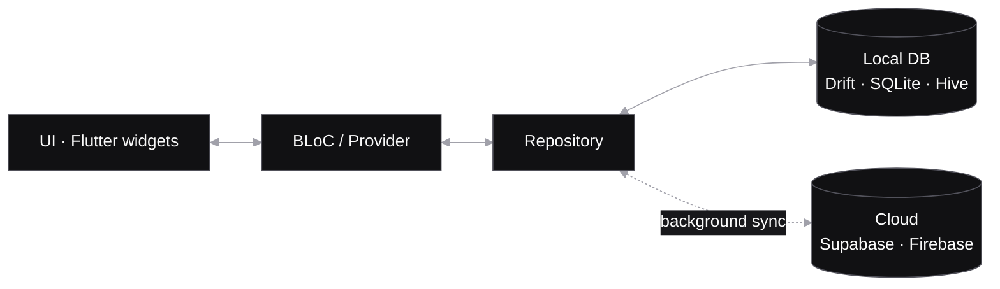

<div align="center">



<br/>

<a href="https://swe-rabia-aziz.vercel.app/"></a>
<a href="https://www.linkedin.com/in/swe-rabiaaziz/"></a>
<a href="https://www.tiktok.com/@swe.rabiaaziz"></a>
<a href="mailto:swe.rabiaaziz@gmail.com"></a>
<a href="https://calendly.com/swe-rabiaaziz/30min"></a>

</div>

<br/>


## 01 · What I do

I take products from a rough idea to a polished, store-ready app. Here is what I deliver to founders and engineering teams:



<br/>


## 02 · Shipped to stores

Four apps live on Google Play, built, designed and released end to end.

<table>
<tr>
<td width="50%" valign="top">

#### ◆ CivicCoach
**AI US Citizenship Test 2026**

An AI oral mock-interview simulator with all 128 official questions, spaced repetition and an offline-first Drift / SQLite database.

<a href="https://play.google.com/store/search?q=CivicCoach%20AI%20US%20Citizenship%20Test&c=apps"></a>

</td>
<td width="50%" valign="top">

#### ◆ ZenPeace
**Pomodoro & Mindful Flow**

A minimalist focus timer with ambient audio soundscapes, reactive `fl_chart` analytics and clean Provider-driven state flow.

<a href="https://play.google.com/store/search?q=ZenPeace%20Pomodoro&c=apps"></a>

</td>
</tr>
<tr>
<td width="50%" valign="top">

#### ◆ Zemen
**Ethiopian Calendar**

A 13-month Ge'ez calendar with a dual Gregorian / Ethiopian date converter and a sunrise clock.

<a href="https://play.google.com/store/search?q=Zemen%20Ethiopian%20Calendar&c=apps"></a>

</td>
<td width="50%" valign="top">

#### ◆ Health Tracker
**Vitals & BP Monitor**

Blood-pressure tracking and pulse trends with private, on-device SQLite storage.

<a href="https://play.google.com/store/search?q=Health%20Tracker%20Vitals%20BP%20Monitor&c=apps"></a>

</td>
</tr>
</table>


## 03 · How I ship

Anyone can make a screen look good in a demo. What matters is whether it still feels right on a mid-range phone, six months and forty features later.

### The performance standard



### Folder architecture

A modular, feature-first structure with a strict dependency rule: `presentation → domain ← data`.

```text
lib/
├── core/                  # theme, router, DI, constants, error handling, utils
├── features/
│   └── <feature>/
│       ├── data/          # remote + local data sources, models, repository impls
│       ├── domain/        # entities, repository contracts, use cases
│       └── presentation/  # pages, widgets, BLoC / Provider
└── main.dart
```

### State management rulebook

| Reach for | When | Why |
| :-- | :-- | :-- |
| **BLoC / Cubit** | Complex async flows: auth, streamed LLM responses, multi-step sessions, anything event-driven | Explicit events and states make flows predictable, testable and easy to trace |
| **Provider** | Reactive UI state: timers, theme, toggles, lightweight view state | Minimal boilerplate and scoped rebuilds for state that stays close to the UI |

### Offline-first principle

The local database is the source of truth. The UI never waits on the network.




## 04 · Tech stack & ecosystem



<br/>

<table>
<tr>
<td width="220"><b>Mobile & Languages</b></td>
<td>


</td>
</tr>
<tr>
<td><b>State Management</b></td>
<td>


</td>
</tr>
<tr>
<td><b>Cloud & Databases</b></td>
<td>


</td>
</tr>
<tr>
<td><b>AI & Hardware</b></td>
<td>


</td>
</tr>
<tr>
<td><b>Tooling</b></td>
<td>


</td>
</tr>
</table>


<!--
=====================================================================
05 · ENDORSEMENTS  (hidden until you add REAL quotes)
Replace the placeholders below with genuine words from the people
named, get their OK, then delete the "<!--" line above and the
"-->" line at the bottom of this block to publish the section.
=====================================================================

## 05 · What collaborators say

<table>
<tr>
<td width="33%" valign="top">

> "PASTE A REAL 1–2 SENTENCE QUOTE HERE."

**Muhammad Uzair**<br/>
<sub>Role / relationship</sub>

</td>
<td width="33%" valign="top">

> "PASTE A REAL 1–2 SENTENCE QUOTE HERE."

**Afaq Zahir**<br/>
<sub>Role / relationship</sub>

</td>
<td width="33%" valign="top">

> "PASTE A REAL 1–2 SENTENCE QUOTE HERE."

**Past project lead**<br/>
<sub>Role / relationship</sub>

</td>
</tr>
</table>


-->

## 05 · Stats & activity

<div align="center">


<br/><br/>

<picture>
  <source media="(prefers-color-scheme: dark)" srcset="https://raw.githubusercontent.com/swe-rabiaaziz/swe-rabiaaziz/output/github-snake-dark.svg"/>
  
</picture>

</div>

<br/>


## 06 · Let's work together



<div align="center">

<br/>

<a href="https://calendly.com/swe-rabiaaziz/30min"></a>
<a href="mailto:swe.rabiaaziz@gmail.com"></a>
<a href="https://swe-rabia-aziz.vercel.app/"></a>

<br/>


</div>
